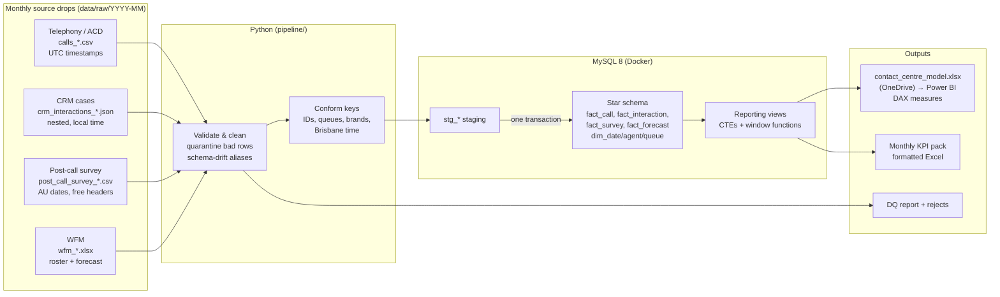

# Contact Centre Reporting Pipeline: KT Insurance & Club 4x4

An end-to-end, one-command monthly refresh for an insurance contact centre. Four source systems that disagree
with each other are cleaned and conformed in **Python**, modelled and analysed in **MySQL**, and served to a
**Power BI** semantic model plus a formatted monthly KPI pack. September is the baseline. October arrives
as a new drop of files and is loaded with a single command.

> All data is synthetic, generated by `scripts/generate_mock_data.py`. Brands are used for context only.



## Run it

Needs **Docker Desktop** and **Python 3.11+**.

```bash
git clone <this repo> && cd eda-contact-centre-pipeline
make setup      # venv + MySQL container + loads September
make refresh    # the monthly "button": loads the next month waiting in data/raw (October)
make verify     # 12 reconciliation checks against the database
make test       # unit tests for the cleaning rules
```

<details>
<summary>Windows / no <code>make</code></summary>

```powershell
python -m venv .venv; .venv\Scripts\activate
pip install -r requirements.txt
copy .env.example .env
docker compose up -d --wait
python -m pipeline.run --month 2026-09
python -m pipeline.run              # next pending month (October)
python scripts\verify.py
```
</details>

Other commands: `make refresh MONTH=2026-10` (reload a specific month), `make demo` (clean slate, load everything),
`make down`. MySQL is exposed on **localhost:3307** (user `eda` / `eda_pass`), so you can explore it in MySQL Workbench.

**Outputs** (paths set in `.env`):

| Output | Path | For |
|---|---|---|
| Power BI model | `output/powerbi/contact_centre_model.xlsx` (+ `csv/`) | Power BI semantic model. Point `EXPORT_DIR` at OneDrive and it refreshes itself |
| KPI pack | `output/reports/Contact_Centre_KPI_Pack_YYYY-MM.xlsx` | Email-ready monthly report: summary vs last month, generated observations, detail tabs |
| Data quality | `output/logs/dq_report_YYYY-MM.json`, `output/rejects/YYYY-MM/` | What was fixed, what was quarantined and why |

Power BI setup (web on Mac, or Desktop on Windows): [`powerbi/POWERBI_SETUP.md`](powerbi/POWERBI_SETUP.md).
Measures: [`powerbi/measures.dax`](powerbi/measures.dax).

## What a monthly refresh does

`python -m pipeline.run` with no arguments finds the earliest month folder that hasn't loaded successfully
(tracked in `etl_run_log`) and runs:

1. **Extract**: one reader per system, each knowing only its own format (CSV, nested JSON, Excel with a title
   block above the header).
2. **Validate and clean**: every rule logs what it found. Untrustworthy rows are **quarantined** to
   `output/rejects/`, never silently dropped. If any source rejects more than 2% of rows, the run **stops before
   touching the database**.
3. **Stage, then merge in one transaction**: dimensions are upserted (`INSERT … ON DUPLICATE KEY UPDATE`). Facts
   use a month-partition swap (`DELETE` month → `INSERT`). Either the whole month lands or none of it does, and
   re-running a month never double counts (CI proves this on every push).
4. **Export**: SQL in `sql/exports/` defines each Power BI table. The workbook is written to a temp file and swapped
   in, so OneDrive never syncs a half-written file.
5. **Report**: the KPI pack is built from the reporting views, with month-on-month change and observations
   generated from the data.

## The mess it handles (planted on purpose)

| Source | Problem | Handling |
|---|---|---|
| Telephony | Timestamps in UTC; export cut on UTC days with overlap | Converted to Brisbane time (no daylight saving). Reporting month assigned on local time, so calls before 10am on the 1st land in the right month. Overlap rows skipped and loaded with their own month |
| Telephony | Same queue spelled 3 ways (`C4X4_SALES`, `Club4x4 Sales`, `c4x4-sales `) | Normalised key → `config/queue_mapping.csv`, owned by the business. The October storm overflow queue was a one-row config change, not a code change |
| Telephony | October release renamed `acw_sec` → `wrap_sec` and added a column | Alias map + warning, not a crash. A genuinely *missing* column is a hard failure |
| Telephony | Duplicate rows, conflicting re-extracts, negative durations, missing IDs | Exact dupes removed. Latest version kept. Invalid rows quarantined |
| Telephony | Calls taken by logins not on the roster (`trainer01`) | Mapped to an `UNKNOWN` agent and reported, so the calls still count |
| Telephony | Outbound callbacks mixed into the inbound log | Excluded from inbound KPIs |
| CRM | Call IDs uppercase, some wrapped in `{}`. Survey IDs have no hyphens | All three formats normalise to one key |
| CRM | Brand as `Club 4x4` / `CLUB 4X4` / `Club4x4` / `KT Ins` | Alias map |
| Survey | Date format switched from `dd/mm/yyyy` to ISO mid-October | Explicit formats only, never month-first guessing |
| Survey | CSAT `N/A`, NPS of 11, customers submitting twice | N/A → null. Out of range → quarantined. Duplicates resolved in SQL with `ROW_NUMBER()` |
| WFM | Title rows above the header. FTE as `0.8` or `80%`. Login case and spacing | Header row detected. FTE parsed. Logins normalised to match telephony |

## SQL layer (`sql/`)

| Folder | What it shows |
|---|---|
| `schema/` | Star schema with indexes. `dim_date` generated by a **recursive CTE**, with Queensland public holidays |
| `merge/` | Idempotent upserts. Month-partition swap. `ROW_NUMBER()` dedupe |
| `views/` | **Multi-CTE** reporting views. `LEAD()` for 7-day repeat contact (FCR). `LAG()` for month-on-month. `RANK`/`NTILE`/windowed `AVG` for agent scorecards. `WITH ROLLUP` + `GROUPING()` for brand subtotals |
| `exports/`, `reports/` | The exact queries behind each Power BI table and each KPI pack tab |

**Metric definitions**
- **Service level** = answered within the queue's threshold ÷ (offered − abandons under 5s). Targets per queue
  in `queue_mapping.csv` (Sales/Retention 80/30, others 80/60).
- **Abandon rate** excludes short abandons. **AHT** = talk + hold + after-call work.
- **FCR** is measured from behaviour, not the survey: no repeat contact from the same policy within 7 days.
  Contacts in the last 7 days of loaded data are excluded until their window closes, so the previous month's FCR
  firms up when the next month loads.
- **NPS** = % promoters (9–10) − % detractors (0–6).

## September → October (what the data shows)

| | Sep | Oct | |
|---|---|---|---|
| Calls offered | 25,520 | 28,703 | +12% |
| Service level | 79.2% | 68.1% | −11.1 pts |
| Abandon rate | 4.3% | 7.1% | +2.8 pts |
| ASA | 28s | 43s | |
| CSAT | 4.01 | 3.88 | |
| Sales conversion | 26.9% | 31.0% | spring campaign |

The story: a hail storm on 12–13 October pushed claims lodgement to more than 4× forecast (KT Insurance alone:
214 calls vs 45 forecast on 13 Oct). The forecast couldn't know about it, and service levels across the centre
fell while service agents were pulled across to claims. A second wave of claims-status enquiries followed a week
later. Six new starters joined on 6 October with longer handle times. Sales improved under the spring campaign.
The QLD King's Birthday holiday (5 Oct) ran claims lines only.

## Automating the cadence in production

The refresh is one idempotent command, so scheduling is trivial: cron/launchd (Mac), Task Scheduler (Windows), or
a scheduled GitHub Action. In a production setting the source drops would arrive by SFTP/API into `RAW_DIR`, MySQL
would be the warehouse (or swapped for Snowflake/SQL Server via the SQLAlchemy URL), and Power BI would refresh
through a gateway or directly from the warehouse.

## Project layout

```
config/queue_mapping.csv     business-owned mapping of raw queue names → queue, brand, SL target
data/raw/YYYY-MM/            monthly source drops (mock)
pipeline/                    extract → transform → quality → load → export, orchestrated by run.py
sql/                         schema, merges, views, exports, report queries
powerbi/                     DAX measures + setup guide
scripts/                     mock data generator, post-load verification
tests/                       unit tests for cleaning rules
.github/workflows/           CI: tests + full Sep→Oct refresh + idempotency + verification
```

---
Built by Yash Bagia · [yashbagia.netlify.app](https://yashbagia.netlify.app)
