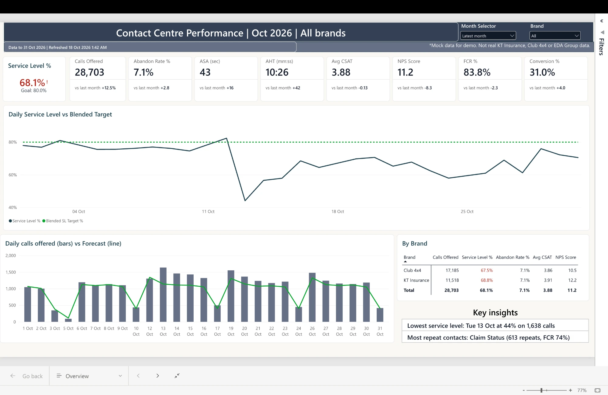
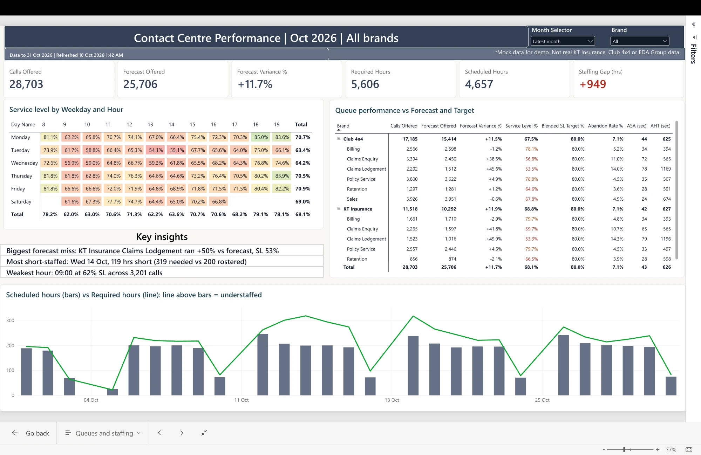
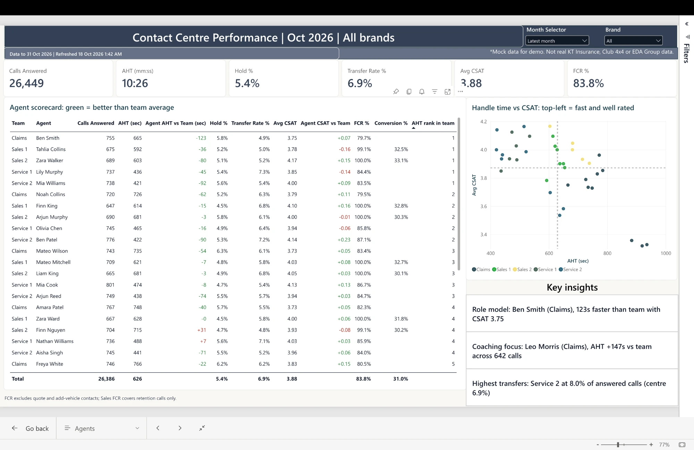
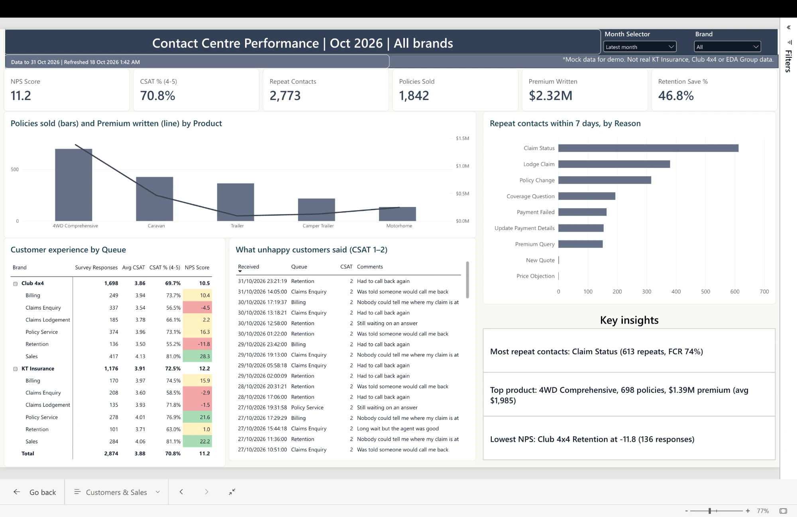
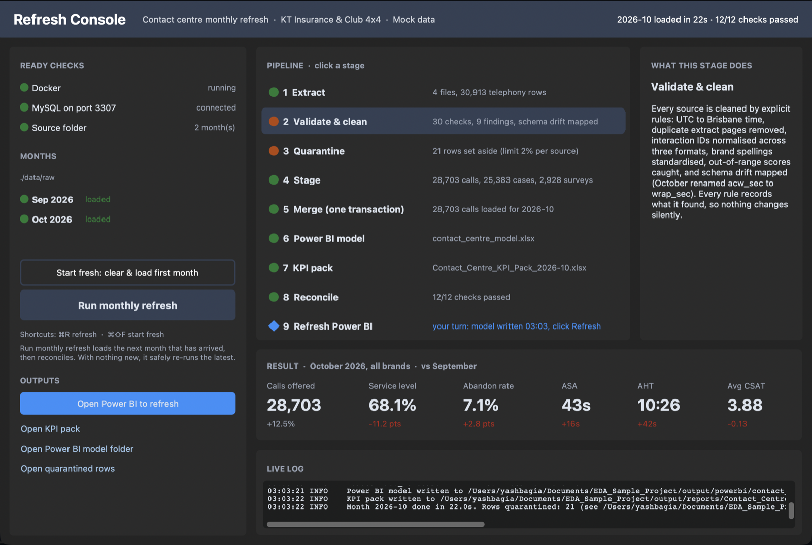
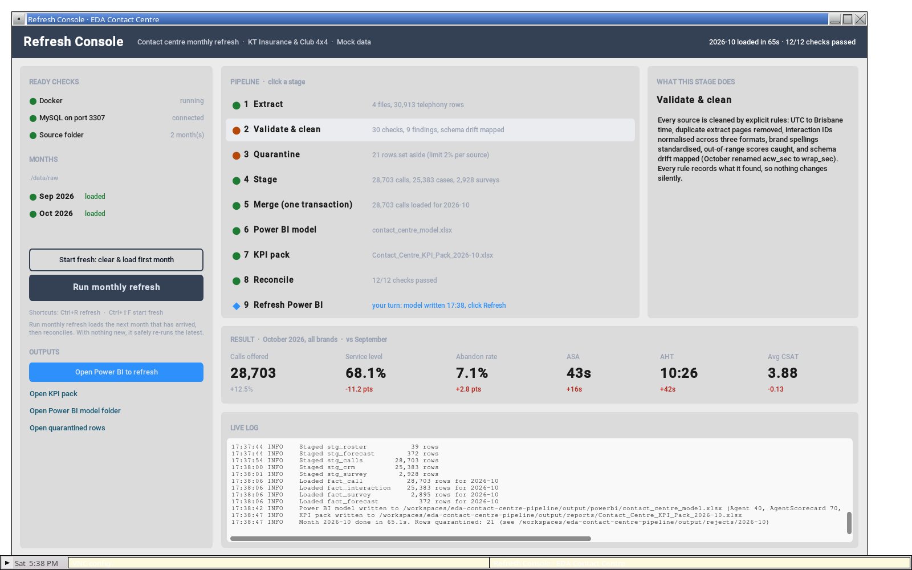
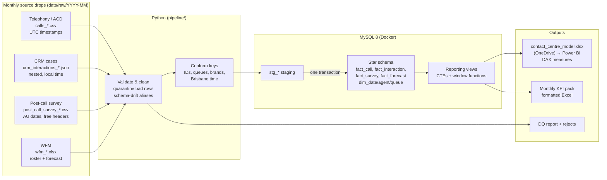

# Contact Centre Reporting Pipeline: KT Insurance & Club 4x4

[](https://github.com/yashbagia1708/eda-contact-centre-pipeline/actions/workflows/pipeline.yml)

A monthly refresh for an insurance contact centre, end to end. Four source systems that disagree with each other
are cleaned and conformed in **Python**, modelled and analysed in **MySQL**, and served to **Power BI** plus a
formatted Excel KPI pack. September is the baseline; October arrives as a new drop of files and is loaded with one
command (or one button).

> All data is synthetic (`scripts/generate_mock_data.py`). Brand names are used for context only; this is not
> KT Insurance, Club 4x4 or EDA Group data.

## Start here

| Time | What to look at |
|---|---|
| **2 min** | ▶️ [Walkthrough video](https://youtu.be/wBzwNJgLSO8): October's files arrive, the refresh runs, the report rolls forward |
| **5 min** | [What October shows](#what-october-shows) and [the dashboard](#the-dashboard) |
| **20 min** | [Run it yourself](#run-it-yourself) in the [Refresh Console](#refresh-console): load September, refresh October, watch every stage, then repoint and refresh the included Power BI report |
| **No install** | [Open it in your browser](#no-docker-run-it-in-your-browser-with-github-codespaces) with Codespaces, Refresh Console included, or [rerun it on GitHub Actions](#or-just-watch-the-pipeline-run-on-github-actions) with one click |
| **Deeper** | [How it works](#how-it-works), the [data problems it handles](#the-mess-it-handles), [SQL](sql/), [DAX](powerbi/measures.dax) |

[](https://youtu.be/wBzwNJgLSO8)

## What October shows

| | Sep | Oct | |
|---|---|---|---|
| Calls offered | 25,520 | 28,703 | +12% |
| Service level | 79.2% | 68.1% | −11.2 pts |
| Abandon rate | 4.3% | 7.1% | +2.8 pts |
| ASA | 28s | 43s | |
| CSAT | 4.01 | 3.88 | |
| Sales conversion | 26.9% | 31.0% | spring campaign |

The story: a hail storm on 12–13 October pushed claims lodgement to more than 4× forecast (KT Insurance alone:
214 calls vs 45 forecast on 13 Oct). The forecast couldn't know about it, and service levels across the centre
fell while service agents were pulled across to claims. A second wave of claims-status enquiries followed a week
later. Six new starters joined on 6 October with longer handle times. Sales improved under the spring campaign.
The QLD King's Birthday holiday (5 Oct) ran claims lines only.

## The dashboard

Four pages in Power BI, every number driven by DAX measures ([`powerbi/measures.dax`](powerbi/measures.dax)) so
they all respond to the Month and Brand slicers. *Latest month* rolls forward on its own after each refresh, the
header and accents take on KT Insurance green or Club 4x4 teal when a brand is picked, and each page ends with
"Key insights" that are calculated from the data rather than typed in.

**Overview**: service level against a volume-weighted target, demand against forecast, brand comparison.


**Queues & Staffing**: forecast accuracy by queue, a weekday × hour service level heatmap, required vs rostered hours.


**Agents**: scorecard against each agent's own team, handle time vs CSAT quadrants, coaching and role-model call-outs.


**Customers & Sales**: repeat contacts by reason, product sales and premium, NPS by queue, what unhappy customers said.


The report ships with **September** loaded ([before](docs/overview_september.png)). Repoint it once to your own
output ([steps](#then-power-bi)), load October, click Refresh, and it moves to October.

## Run it yourself

Needs **Docker Desktop** (running) and **Python 3.11+**.

```bash
git clone https://github.com/yashbagia1708/eda-contact-centre-pipeline.git
cd eda-contact-centre-pipeline
```

No Docker or Python on this machine? Use [Codespaces](#no-docker-run-it-in-your-browser-with-github-codespaces) (the Refresh Console in your browser) or [GitHub Actions](#or-just-watch-the-pipeline-run-on-github-actions) (one click, no app just the workflow).

### Refresh Console

The monthly refresh in one window. It checks Docker and MySQL (and starts the database if needed), watches the
source folder so a new month lights up the moment its files land, and runs the pipeline with every stage lit up as it
goes: row counts, data-quality findings, 12 reconciliation checks, then the hand-off to Power BI. Click any stage to
see what it does and why.



**Why a Python app and not an `.exe`?** One `app.py` runs the same on Windows and Mac, and it's readable code from
this repo rather than an unsigned executable from an unknown sender, which corporate laptops typically block (Windows
SmartScreen, endpoint protection) and email filters strip.

**Open it**

| Mac / Linux | Windows (PowerShell, no activation needed) |
|---|---|
| `make app` | `python -m venv .venv`<br>`.venv\Scripts\python -m pip install -r requirements.txt`<br>`copy .env.example .env`<br>`.venv\Scripts\python app.py` |

**Use it**

1. **Start fresh** loads September, the baseline (25,520 calls, 12/12 checks).
2. **Run monthly refresh** loads the next month waiting in `data/raw`, which is October: watch the schema drift get
   mapped, 21 rows quarantined, and the checks pass.
3. **Open Power BI to refresh** opens the report: refresh it and it rolls forward to October.

Shortcuts: ⌘R / Ctrl+R refresh, ⌘⇧F / Ctrl+Shift+F start fresh.

### Then Power BI

Open [`powerbi/contact_centre.pbix`](powerbi/contact_centre.pbix) in Power BI Desktop. It opens on **September** and
every page works straight away.

**Before you click Refresh, repoint it to your own output (one time, about 2 minutes).** The report was built in
Power BI web against the author's OneDrive, so its 8 queries still point there; Refresh would ask for a sign-in you
don't have. Point them at the workbook the pipeline wrote on your machine:

1. **Home → Transform data**. In the Power Query Editor, select the `Agent` query, then its **Source** step under
   *Applied steps*.
2. Replace the formula in the formula bar with this, using the path of your clone:
   ```
   = Excel.Workbook(File.Contents("C:\eda-contact-centre-pipeline\output\powerbi\contact_centre_model.xlsx"), null, true)
   ```
3. Do the same for `Calls`, `Date`, `Forecast`, `Interactions`, `Queue`, `RefreshLog` and `Surveys`.
4. **Close & Apply** (choose *Organizational* if asked about privacy levels).

Now the loop works: **Run monthly refresh** in the Refresh Console (or `make refresh`), then **Refresh** in Power BI,
and the report rolls forward to October on its own. More detail: [`POWERBI_SETUP.md`](powerbi/POWERBI_SETUP.md#using-the-included-report-contact_centrepbix).

### No Docker? Run it in your browser with GitHub Codespaces

The same Refresh Console, on a cloud machine GitHub sets up for you. Nothing to install:

1. On the repo page, click **Code → Codespaces → Create codespace on main**. The first start takes about 5
   minutes; it installs Python, Docker and the packages for you.
2. In the **Ports** tab, open **Desktop (Refresh Console)** (port 6080) in the browser and click **Connect**.
3. In the codespace terminal, run `python app.py`. The Refresh Console opens on that browser desktop, starts MySQL
   itself, and works as above: **Start fresh**, then **Run monthly refresh**.

**Good to know**

- **No Power BI in a codespace.** It's a Linux machine in the cloud, and Power BI Desktop is Windows-only, so the
  console's **Open Power BI to refresh** button (stage 9) has nothing to open there. The pipeline still writes the
  Power BI model workbook; the report itself needs [Power BI Desktop on your machine](#then-power-bi).
- **The console's Open buttons don't open files there either** (KPI pack, model folder, quarantined rows). Outputs
  land in `output/`: right-click a file in the codespace Explorer → **Download** to open a KPI pack in Excel.
- **First start takes about 5 minutes**; later starts of the same codespace are quick. A run is a little slower than
  on a laptop (2 cores), and the console shows in light mode.
- **Usage counts against your own GitHub account's** free monthly Codespaces allowance (a run uses a few minutes of
  it). Delete the codespace when you're done: **Code → Codespaces → … → Delete**.



### Or just watch the pipeline run on GitHub Actions

One click, nothing to install, no window: the same pipeline on GitHub's servers, with the outputs to download.

1. Open **[Actions → pipeline](https://github.com/yashbagia1708/eda-contact-centre-pipeline/actions/workflows/pipeline.yml)** and click **Run workflow → Run workflow**.
2. In about 3 minutes a fresh machine starts an empty MySQL 8, runs the unit tests, loads September, finds and
   loads October (schema drift mapped, bad rows quarantined), re-runs October to prove nothing double counts, and
   passes the 12 reconciliation checks. Expand any step to read its log.
3. Under **Artifacts** at the bottom of the run, download **outputs**: the Power BI model workbook, both monthly
   KPI packs (Excel), the run logs and the quarantined rows.

The Refresh Console is a desktop window, so it doesn't run in Actions: GitHub's runners have no screen to show it
on. This run is the same pipeline without the window: the same stages, logs, checks and outputs. To use the Refresh
Console without installing anything, [use Codespaces](#no-docker-run-it-in-your-browser-with-github-codespaces).

Every push runs the same job, so the [latest runs](https://github.com/yashbagia1708/eda-contact-centre-pipeline/actions) are already there to look at.

<details>
<summary><b>Prefer the command line?</b> The same pipeline without the window, plus outputs and extra commands</summary>

**Mac / Linux**

```bash
make setup      # venv + MySQL container + loads September
make refresh    # the monthly refresh: loads October, the next month waiting in data/raw
make verify     # 12 reconciliation checks against the database
make test       # unit tests
```

**Windows (PowerShell)**

```powershell
python -m venv .venv
.venv\Scripts\python -m pip install -r requirements.txt
copy .env.example .env
docker compose up -d --wait
.venv\Scripts\python -m pipeline.run --month 2026-09   # baseline: September
.venv\Scripts\python -m pipeline.run                   # the monthly refresh: loads October
.venv\Scripts\python scripts\verify.py                 # 12 reconciliation checks
```

Other commands: `make refresh MONTH=2026-10` (reload a specific month), `make demo` (clean slate, load everything),
`make down`. MySQL is exposed on **localhost:3307** (user `eda` / `eda_pass`), so you can explore it in MySQL Workbench.

**Outputs** (paths set in `.env`):

| Output | Path | For |
|---|---|---|
| Power BI model | `output/powerbi/contact_centre_model.xlsx` (+ `csv/`) | The Power BI semantic model's source. Point `EXPORT_DIR` at OneDrive and Power BI web refreshes from it |
| KPI pack | `output/reports/Contact_Centre_KPI_Pack_YYYY-MM.xlsx` | Email-ready monthly report: summary vs last month, generated observations, detail tabs |
| Data quality | `output/logs/dq_report_YYYY-MM.json`, `output/rejects/YYYY-MM/` | What was fixed, what was quarantined and why |

Building the Power BI model from scratch instead (web on a Mac, or Desktop): [`powerbi/POWERBI_SETUP.md`](powerbi/POWERBI_SETUP.md).

</details>

## How it works



`python -m pipeline.run` with no arguments finds the earliest month folder whose latest run didn't succeed
(tracked in `etl_run_log`) and runs:

1. **Extract**: one reader per system, each knowing only its own format (CSV, nested JSON, Excel with a title
   block above the header).
2. **Validate and clean**: every rule logs what it found. Untrustworthy rows are **quarantined** to
   `output/rejects/`, never silently dropped. If any source rejects more than 2% of rows, the run **stops before
   touching the database**.
3. **Stage, then merge in one transaction**: dimensions are upserted (`INSERT … ON DUPLICATE KEY UPDATE`). Facts
   use a month-partition swap (`DELETE` month → `INSERT`). Either the whole month lands or none of it does, and
   re-running a month never double counts (CI proves this on every push).
4. **Export**: SQL in `sql/exports/` defines each Power BI table. The workbook is written to a temp file and swapped
   in, so OneDrive never syncs a half-written file.
5. **Report**: the KPI pack is built from the reporting views, with month-on-month change and observations
   generated from the data.

### The mess it handles

<details>
<summary>Data problems planted in the mock sources, and how each is handled</summary>

| Source | Problem | Handling |
|---|---|---|
| Telephony | Timestamps in UTC; export cut on UTC days with overlap | Converted to Brisbane time (no daylight saving). Reporting month assigned on local time, so calls before 10am on the 1st land in the right month. Overlap rows skipped and loaded with their own month |
| Telephony | Same queue spelled 3 ways (`C4X4_SALES`, `Club4x4 Sales`, `c4x4-sales `) | Normalised key → `config/queue_mapping.csv`, owned by the business. The October storm overflow queue was a one-row config change, not a code change |
| Telephony | October release renamed `acw_sec` → `wrap_sec` and added a column | Alias map + warning, not a crash. A genuinely *missing* column is a hard failure |
| Telephony | Duplicate rows, conflicting re-extracts, negative durations, missing IDs | Exact dupes removed. Latest version kept. Invalid rows quarantined |
| Telephony | Calls taken by logins not on the roster (`trainer01`) | Mapped to an `UNKNOWN` agent and reported, so the calls still count |
| Telephony | Outbound callbacks mixed into the inbound log | Excluded from inbound KPIs |
| CRM | Call IDs uppercase, some wrapped in `{}`. Survey IDs have no hyphens | All three formats normalise to one key |
| CRM | Brand as `Club 4x4` / `CLUB 4X4` / `Club4x4` / `KT Ins` | Alias map |
| CRM | Case assigned to an agent ID that isn't on the roster, or no agent at all | Mapped to the `UNKNOWN` agent and reported, the same rule as telephony, so the case still counts |
| CRM | About 9 cases a month have no matching call in telephony (often answered just before month end) | Kept, and grouped under their brand's *Not linked to a call* queue so brand totals reconcile in Power BI |
| Survey | Date format switched from `dd/mm/yyyy` to ISO mid-October | Explicit formats only, never month-first guessing |
| Survey | CSAT `N/A`, NPS of 11, customers submitting twice (even in different months' files) | N/A → null. Out of range → quarantined. Latest response wins via `ROW_NUMBER()`, across months too, so the result doesn't depend on load order |
| WFM | Forecast row for a brand + queue group with no queue in the mapping | Quarantined with the reason, instead of failing the load with a database error |
| WFM | Title rows above the header. FTE as `0.8` or `80%`. Login case and spacing | Header row detected. FTE parsed. Logins normalised to match telephony |

</details>

### SQL layer and metric definitions

<details>
<summary>What each <code>sql/</code> folder shows, and how every KPI is defined</summary>

| Folder | What it shows |
|---|---|
| `schema/` | Star schema with indexes. `dim_date` generated by a **recursive CTE**, with Queensland public holidays |
| `merge/` | Idempotent upserts. Month-partition swap. `ROW_NUMBER()` dedupe |
| `views/` | **Multi-CTE** reporting views. `LEAD()` for 7-day repeat contact (FCR). `LAG()` for month-on-month. `RANK`/`NTILE`/windowed `AVG` for agent scorecards. `WITH ROLLUP` + `GROUPING()` for brand subtotals |
| `exports/`, `reports/` | The exact queries behind each Power BI table and each KPI pack tab |

**Metric definitions**
- **Service level** = answered within the queue's threshold ÷ (offered − abandons under 5s). Targets per queue
  in `queue_mapping.csv` (Sales/Retention 80/30, others 80/60).
- **Abandon rate** excludes short abandons. **AHT** = talk + hold + after-call work.
- **FCR** is measured from behaviour, not the survey: no repeat contact from the same policy within 7 days.
  Contacts in the last 7 days of loaded data are excluded until their window closes, so the previous month's FCR
  firms up when the next month loads.
- **NPS** = % promoters (9–10) − % detractors (0–6).

</details>

## Running it in production

The refresh is one idempotent command, so scheduling is trivial: cron/launchd (Mac), Task Scheduler (Windows), or
a scheduled GitHub Action. In a production setting the source drops would arrive by SFTP/API into `RAW_DIR`, MySQL
would be the warehouse (or swapped for Snowflake/SQL Server via the SQLAlchemy URL), and Power BI would refresh
through a gateway or directly from the warehouse.

**Why OneDrive in the demo.** Built on a Mac with Power BI web: the service can't reach a database on a laptop
without an on-premises gateway, and the gateway is Windows-only. A workbook in OneDrive is reached cloud-to-cloud,
so the pipeline writes `contact_centre_model.xlsx` there and the semantic model refreshes from it. Only the source
step would change in EDA's tenant: the model would read the warehouse through a gateway, or the whole flow would
run as a Microsoft Fabric pipeline, and the last pipeline step would call the Power BI REST API to refresh the model
so nobody has to click Refresh.

## Project layout

```
config/queue_mapping.csv     business-owned mapping of raw queue names → queue, brand, SL target
data/raw/YYYY-MM/            monthly source drops (mock)
app.py                       Refresh Console: the monthly refresh in one window (CustomTkinter)
pipeline/                    extract → transform → quality → load → export, orchestrated by run.py;
                             checks.py holds the post-load reconciliation checks
sql/                         schema, merges, views, exports, report queries
powerbi/                     the report (.pbix), DAX measures, theme, setup guide
scripts/                     mock data generator, post-load verification
.devcontainer/               GitHub Codespaces setup: Python, Docker for MySQL, a browser desktop for the console
docs/                        dashboard and Refresh Console screenshots
tests/                       unit tests for cleaning rules
.github/workflows/           CI: tests + full Sep→Oct refresh + idempotency + verification
```

---
Built by Yash Bagia · [yashbagia.netlify.app](https://yashbagia.netlify.app)
